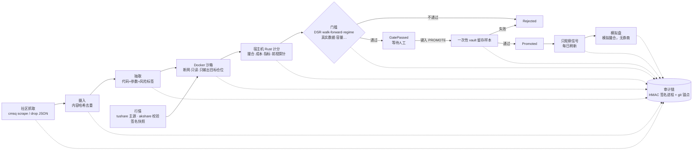

# 设计逻辑与理念（DESIGN）

这份文档回答"为什么这样设计"。怎么用见 [QUICKSTART.md](QUICKSTART.md)，参数见 [CONFIG.md](CONFIG.md)。

## 1. 一句话
从社区抓来的量化策略，**默认都是不可信的**：代码可能作弊（偷看未来、伪造结果、联网），结果可能是运气（过拟合、多重检验）。
系统的目标不是"找到赚钱策略"，而是**用尽量诚实的方法证明某个策略不是假的**；证明不了，就拒绝。

## 2. 流水线

状态机：`Ingested → Extracted → Backtesting → GatePassed → (promote + vault) → Promoted / Rejected`，出错进 `Failed`。

## 3. 为什么要这么多道门槛

一条社区策略"看起来很赚钱"，常见原因有三类，每类都有对应的门槛：

**A. 代码在作弊**
- **信任拆分**：策略代码只在沙箱里运行，只能写一个文件 `/out/positions.csv`（每根 K 线的目标仓位）。
  成交、手续费、印花税、涨跌停、指标、门槛**全部由宿主机上的 Rust 代码计算**，容器自报的任何"收益"都被忽略（攻击样例 `forge.json` 就是伪造 result.json）。
- **沙箱**：断网（`NetworkMode=none`）、只读文件系统、非 root、去掉全部权限、进程/内存/时间/输出大小上限。
- **前视探针（`no_lookahead`）**：同一策略在约 40 个变体上重跑——截断未来、把未来收益取反（mirror）、块自助重采样，每个变体一个全新容器、随机顺序。
  如果"改了未来，过去的仓位跟着变"，就是在偷看未来。容器里看到的日期是平移过的假日期、时钟冻结在 2000-01-01，减少"知道今天是哪天"的作弊空间。
- **静态检查（`static_risks`）**：`shift(-n)`、`i+k` 索引、负 `np.roll` 等明显的未来访问。

**B. 结果是运气（过拟合）**
- **Deflated Sharpe Ratio（`deflated_sharpe` ≥ 0.95）**：试得越多，碰巧撞上高 Sharpe 的概率越大。系统维护**全库试验账本**（`cmsq trials`），
  按"策略+参数+标的+快照+窗口+运行类型+组合"计数，N 至少取 20（社区帖子是作者挑过的，他失败的尝试我们看不见）。参数扫描、GA 搜索的每个点都计入 N，所以"搜得越多，门槛越高"。
- **walk-forward（≥3/4 折为正）**：开发段前 20% 预热，剩下切 4 折，要求大多数时间段都赚钱；参数扫描时每折只用之前的数据重新选参。
- **市场状态稳定性（`regime_stability`）**：只在牛市或只在高波动里赚钱的策略不算数。
- **一次性 vault 留存样本**：最后 20% 的数据在人工确认前**谁都看不到**，确认后只运行一次（先记录消耗再运行），换个标题重发同一想法也拿不到第二次。
- **其他**：Sharpe ≥ 0.5、净收益为正、2 倍成本下仍为正、最大回撤不差于 −35%、平均敞口 ≥ 5%、Sharpe 高于同期买入持有、至少 250 根 K 线。

**C. 数据或规模有问题**
- **真实数据来源（`real_market_data`）**：只认带签名留证的 tushare/rstdx 抓取；快照的 sha256 必须与审计链里的抓取记录一致。合成数据、手工 CSV 一律不放行（DEMO 除外，见下）。
- **交叉校验（`data_cross_validated`）**：tushare 与 akshare 逐日核对收盘价，差异 >0.1% 的日子超过 max(3, 重叠/500) 天或任一天 >1% 即阻断。
- **复权（`data_adjusted`）**：必须有复权因子。
- **容量（`capacity`）**：90% 的成交不超过当日成交额的 5%，容量估计至少 ¥100 万。

## 4. 为什么大多数策略都被拒
这是**设计意图**，不是故障。截至 2026-10-22，真实数据上没有任何社区策略通过：最好的一次是双均线在 SZ300750 上 Sharpe 1.25，但 DSR 只有 0.837（需 0.95）。
公开流传的简单策略大多已被市场消化，加上成本和多重检验，剩下的优势通常不足以和运气区分开。
一个"什么都不放过"的系统比一个"偶尔放过假策略"的系统更有价值：后者会让你在实盘里替运气买单。
所有"通过/晋升/有信号/有模拟成交"的截图都来自 **DEMO 工作区**（合成数据 + 放宽门槛，黄色横幅），只演示机制。

## 5. 只观察、无实盘
- 系统里**没有任何下单接口**：CTP 只编译行情 API（`cmsq md`），模拟盘 crate 没有网络或券商依赖，有测试（`tests/no_order_path.rs`）守护。
- 晋升后的策略只产生**观察信号**（`cmsq signals --refresh`），每日在沙箱里重跑并再次做前视探针。实盘衰减（晋升后回撤差于 −20% 等）**只告警不自动降级**——降级是你的不可逆决定（`cmsq reject`）。
- 晋升需要人键入 `PROMOTE <id前8位>`：关键决定留给人。

## 6. 审计：为什么要签名进程和锚点
每一步（抓取、行情、回测、门槛、晋升、信号、模拟盘）都追加写入审计链，每条带 HMAC-SHA256，后一条包含前一条的 MAC。
- **签名进程（默认）**：密钥只存在 `cmsq-signer` 容器卷里（uid 10001，无网络），应用经本地 socket 请它签"下一条"，自己读不到密钥，也拿不到改写历史所需的 MAC。
- **锚点**：链头写到密钥目录外的锚点文件；可选每小时把链头提交（SSH 签名）并推送到私有 git 仓库（`--anchor-repo`），`cmsq audit verify-git` 校验历史上所有锚点。
- **密钥绝不进 git**，git 里只放锚点。`cmsq audit verify` 能检出修改、删除、截断、回滚、重链。细节见 [AUDIT_KEY.md](AUDIT_KEY.md)。

## 7. 存储：为什么是 PostgreSQL + TimescaleDB
- 回测、参数扫描、组合会并行跑很多容器（容器槽位默认等于 CPU 数），SQLite 的单写者模型不够；PG 提供并发写、advisory lock、行级 CAS。
- **最小权限**：迁移用 `cmsq_owner`，运行时用 `cmsq_app`，后者对审计/试验/证据表只能插入和读取，不能改、删、TRUNCATE 或关触发器。
- K 线与 tick 用 TimescaleDB hypertable。每个工作区一个 schema。只监听 127.0.0.1。SQLite 只保留给测试/离线（`CMSQ_DB=sqlite`）。

### Redis 热层（可选）
`--hot` 启用。只放可丢弃的东西：最新行情缓存、看板推送、多进程共享的数据源限流。**PG 永远是权威数据**，Redis 挂了 300 ms 内自动降级。见 [REDIS.md](REDIS.md)。

## 8. 模拟盘撮合模型
对**真实行情报价**撮合（不是参与者之间的订单簿）：市价单按对手一档成交；被动限价单默认只有成交价**严格穿过**限价才成交（`trade_through`，保守）；
每笔不超过新增成交量的 10%（`--participation`）；涨停不买、跌停不卖；A 股 T+1、100 股一手、佣金与印花税；期货平今/平昨、保证金、按结算价盯市。
订单与成交按哈希链存 PG，可导出 QIFI。只允许 Promoted 策略下模拟单。见 [PAPER_TRADING.md](PAPER_TRADING.md)。

## 9. 关键取舍与已知局限
| 取舍 / 局限 | 说明 |
|---|---|
| 宁可误杀 | 门槛偏严，可能拒掉真正有效但证据不足的策略 |
| 日线为主 | 分钟级需要额外数据权限；`--from-bars` 可回放分钟 K 线做模拟盘 |
| 时钟渠道 | vDSO 直接读时间、文件 ctime 在 Linux 上无法伪造；靠假日期兜底（知道今天也推不出数据截断位置） |
| 稀疏偷看 | 只偶尔偷看未来的策略只能概率性抓到 |
| DEV 后端 | bubblewrap 后端（`--backend process`）只用于开发，/out 上限靠 50 ms 轮询，结果**永不可晋升** |
| 交叉校验来源 | 实际只有 tushare↔akshare 一对；只有 tushare 有复权因子 |
| 单机 | 一台机器一个共享数据库；签名进程与应用同机 |
| CTP 实时行情 | 本机连不上 openctp，实时源只用回放测试过 |
| 价格形态 | 真实价格本身可能泄露年代 |

更细的开发历史见 [CHANGELOG.md](CHANGELOG.md)，对抗审查记录见 `docs/reviews/`。
