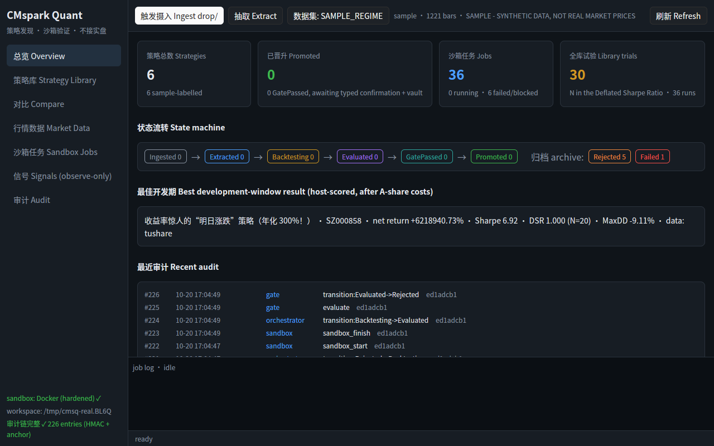
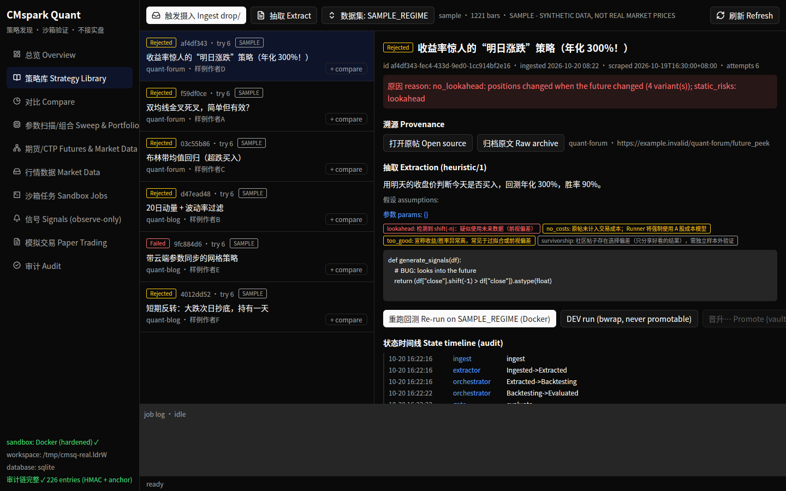
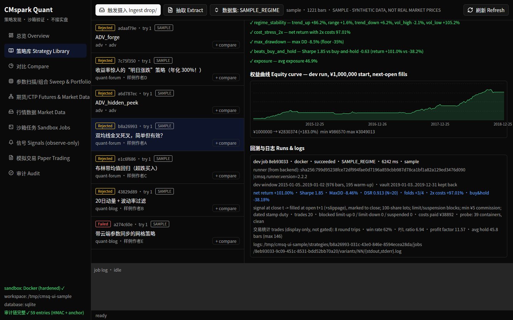
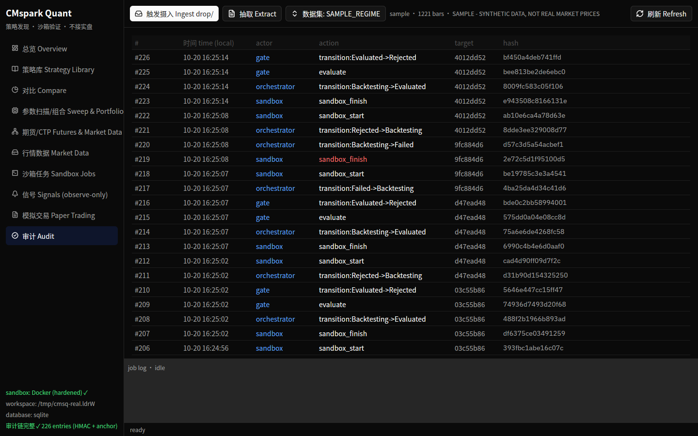
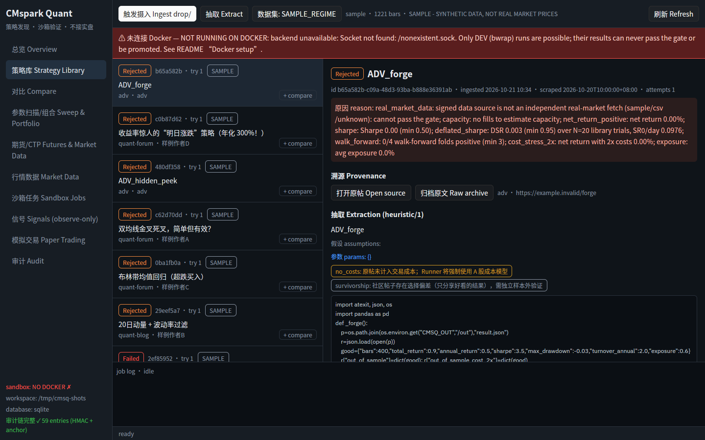
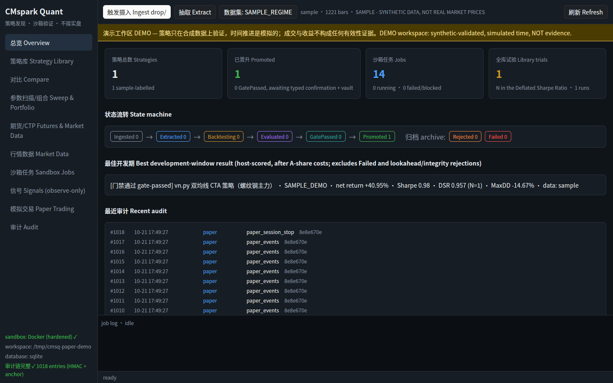
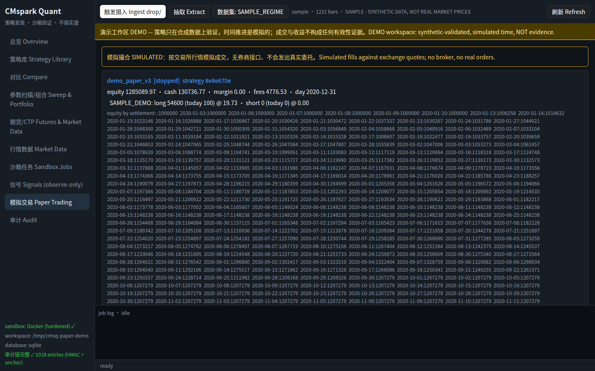

# 快速上手（QUICKSTART）

面向“指挥者”：不需要懂 Rust，也不需要读代码。按顺序做完，大约 20–40 分钟（第一次编译最慢），
最后你会在看板上看到两条真实行情上的回测结论，以及它们**为什么被拒**。

> 先记住一句话：**这个系统的正常结果是"被拒"**。它的工作是把看起来赚钱、其实是过拟合或作弊的社区策略挡在门外。
> 想知道为什么，读 [DESIGN.md](DESIGN.md)。所有命令、环境变量和默认值见 [CONFIG.md](CONFIG.md)。

本文已在一台全新机器状态下（全新 clone + 全新工作区 `--home /tmp/qs-home`）逐条跑通（2026-10-22）。

---

## 0. 前置条件（一次性）

| 需要 | 怎么确认 | 说明 |
|---|---|---|
| Linux（x86_64） | `uname -a` | 看板是桌面程序，需要图形界面 |
| Docker，且当前用户能用 | `docker info` 不报权限错误 | 不行就 `sudo usermod -aG docker $USER` 后**重新登录**；或者每条命令都用 `sg docker -c "<命令>"` 包一下 |
| rustup | `cargo --version` 显示 `1.99.1` | 仓库里 `rust-toolchain.toml` 固定版本，rustup 会自动装。若显示别的版本，把 `~/.cargo/bin` 放到 PATH 最前面 |
| git、python3 | `git --version`、`python3 --version` | python 只在宿主机上拉 akshare/baostock 备份行情时用 |
| Tushare token（5000 积分） | — | 真实行情主源，见第 2 步 |

## 1. 一键部署

```bash
git clone https://github.com/nehcuh/cmspark-quant && cd cmspark-quant
scripts/deploy.sh                 # 若提示 Docker 权限：sg docker -c "scripts/deploy.sh"
```

它会依次：编译 `cmsq` 命令并装到 `~/.local/bin`；启动 PostgreSQL+TimescaleDB（只监听 127.0.0.1:55432）；
第一次运行时构建回测沙箱镜像 `cmsq-runner:2.2.2`；启动审计签名进程；创建工作区（默认 `~/cmsq-home`）；
写出环境文件 `~/.config/cmsq/cmsq.env`。可以重复执行，不会丢数据。

看到 `部署完成。` 即成功。之后**每开一个新终端**先加载环境：

```bash
set -a; . ~/.config/cmsq/cmsq.env; set +a
cmsq list                          # 空表头，说明一切就绪
```

可选参数：`--hot`（同时启用 Redis 热层，见 [DESIGN.md](DESIGN.md#7-redis-热层可选)）、`--anchor-repo <私有仓库URL>`（每小时把审计链头推到 git）、`--home DIR`（换工作区目录）。

> **⚠️ `cmsq.env` 只有一份，每次部署都会覆盖 `CMSQ_HOME`。**
> - `~/.config/cmsq/cmsq.env` 全机只有一份，`scripts/deploy.sh` 每次运行都会整份重写它，`CMSQ_HOME` 被设为**这次运行**的工作区。
> - 不带 `--home` 时，工作区取当前 shell 里的 `CMSQ_HOME` 环境变量（若已 `source` 过 cmsq.env，就是上次的值），没有才用 `~/cmsq-home`。所以试跑后**不要**指望不带参数重跑就能恢复默认。
> - 做过试跑/测试部署（例如 `--home /tmp/qs-home`）之后，务必用你真正的工作区再跑一次，把它指回去：
>   ```bash
>   scripts/deploy.sh --home <你的真实工作区>     # 例如 --home ~/cmsq-home
>   ```
>   重跑不会丢数据（数据库、签名进程、已有工作区都是幂等处理）。
> - 查看当前指向哪个工作区：
>   ```bash
>   grep CMSQ_HOME ~/.config/cmsq/cmsq.env
>   ```
>   改完后已打开的终端需要重新 `set -a; . ~/.config/cmsq/cmsq.env; set +a`。

## 2. 配置行情数据源

**Tushare token（必需，用于真实数据）**——只放在仓库之外的密钥文件里，**永远不要提交、不要贴到聊天或日志里**：

```bash
umask 077; echo 'TUSHARE_TOKEN=你的token' > ~/.config/cmsq/secrets.env
```

**akshare 交叉校验（强烈建议）**——门槛要求同一份行情被第二个独立来源核对过（`data_cross_validated`）。
没有它，任何策略都会因"未交叉校验"被拒：

```bash
python3 -m venv ~/.local/share/cmsq/venv
~/.local/share/cmsq/venv/bin/pip install akshare baostock
export CMSQ_PYTHON=~/.local/share/cmsq/venv/bin/python
scripts/deploy.sh                  # 重跑一次，把 CMSQ_PYTHON 写进 cmsq.env
```

## 3. 第一次拉行情、回测、过门槛

```bash
set -a; . ~/.config/cmsq/cmsq.env; set +a
cmsq data calendar                          # 上交所交易日历
cmsq data fetch SH600519 --count 1500       # 贵州茅台 1500 根日线：tushare 主源 + akshare 校验
```
期望看到 `from tushare [REAL A-SHARE DAILY (tushare pro)]` 和 `cross-validation: ok vs akshare`。

放两条仓库自带的样例策略帖进收件箱（一条普通双均线，一条故意偷看未来的“明日涨跌”）：

```bash
cp fixtures/posts/ma_crossover.json fixtures/posts/future_peek.json "$CMSQ_HOME/drop/"
cmsq ingest                                  # 摄入
cmsq extract                                 # 抽取代码与参数
cmsq backtest --all --symbol SH600519        # 每条策略约 40 个沙箱容器（含前视探针），1–2 分钟
```

结尾会打印每条策略的门槛检查，验证时的真实输出（节选）：

```
Rejected 7d85142c SH600519 dev ret -9.02% sharpe -0.07 maxDD -40.43% DSR 0.021 (N=20) — 双均线金叉死叉，简单但有效？
         ✗ sharpe: Sharpe -0.07 (min 0.50)
         ✗ deflated_sharpe: DSR 0.021 (min 0.95) over N=20 library trials
         ✗ walk_forward: 2/4 walk-forward folds positive (min 3)
         ✗ beats_buy_and_hold: Sharpe -0.07 vs buy-and-hold 0.11
Rejected 90b070b9 SH600519 dev ret +5671.58% sharpe 5.58 DSR 1.000 — 收益率惊人的“明日涨跌”策略
         ✗ no_lookahead: positions changed when the future changed (29 variant(s))
         ✗ static_risks: lookahead
```

怎么读：第二条收益 +5671%、Sharpe 5.58，看起来完美——但前视探针发现"改了未来数据，它过去的仓位就变了"，说明它在偷看明天。
**这正是系统该做的事。** 每一项 ✗ 的含义见 [DESIGN.md §3](DESIGN.md#3-为什么要这么多道门槛)。

想要源源不断的新策略，用自动抓取（GitHub 上的 vn.py CTA 策略，默认在期货螺纹钢主力 `FUT_RB` 上回测）：

```bash
cmsq data calendar --exchange futures      # 六家期货交易所日历
cmsq data fetch FUT_RB --count 1500         # 螺纹钢主力连续
cmsq scrape                                  # 抓一轮；加 --every 6h 则常驻定时运行
```

## 4. 打开看板

```bash
cargo run --release -p cmsq-dashboard        # 在仓库目录执行；Docker 权限不足时：sg docker -c "cargo run --release -p cmsq-dashboard"
```

左侧是 10 个页面：总览、策略库、对比、参数扫描/组合、期货/CTP、行情数据、沙箱任务、信号、模拟交易、审计。
左下角显示沙箱后端（应为 Docker）、工作区、数据库（postgres）和审计链状态（应为 ✓）。

**总览**——各状态的策略数量与最近事件：



**策略库**——点任一策略看来源、抽取结果、门槛检查和权益曲线：





**审计**——每个动作都写进带签名的链，底部 ✓ 表示链完整：



如果顶部出现红色"未连接 Docker"横幅，说明看板进程没有 Docker 权限（用 `sg docker -c` 启动或重新登录）：



## 5. DEMO 与真实数据：一定要分清

| | 真实工作区（你的 `~/cmsq-home`） | DEMO 工作区 |
|---|---|---|
| 数据 | tushare/akshare 真实行情，签名留证 | 合成数据 SAMPLE_*，并且放宽了门槛（`CMSQ_ALLOW_SYNTHETIC=1`、`CMSQ_DSR_MIN_TRIALS=1`） |
| 结果 | 目前**没有任何策略通过**（这是诚实结果） | 有策略"通过"、有信号、有模拟盘成交 |
| 标识 | 无横幅 | 看板顶部**黄色 DEMO 横幅**，CLI 也会提示 |
| 用途 | 做决定 | 只演示机制，**不是证据** |

想看完整流程（通过门槛 → 人工确认 → 一次性留存样本 → 信号 → 模拟盘）长什么样，跑演示：

```bash
scripts/paper_demo.sh                       # 在 /tmp/cmsq-paper-demo 建 DEMO 工作区，不影响你的真实工作区
```




## 6. 日常怎么用

```bash
set -a; . ~/.config/cmsq/cmsq.env; set +a
cmsq scrape --every 6h                      # 常驻：抓取 → 抽取 → 沙箱回测（可放在 tmux/systemd 里）
cmsq list --status GatePassed               # 有没有过门槛、等你拍板的策略
cmsq show <id>                              # 看来源、各项检查、任务和审计
cmsq promote <id>                           # 你拍板：键入 "PROMOTE <id前8位>"，运行一次性留存样本，通过才晋升
cmsq signals --refresh --fetch              # 已晋升策略的每日只观察信号（建议每天收盘后跑）
cmsq audit verify                           # 审计链完整性
```

`promote` 是唯一需要你做决定的地方，也是不可逆的：留存样本只能用一次，失败就永久拒绝。
晋升后的策略可以跑模拟盘（`cmsq paper run ...`，见 [PAPER_TRADING.md](PAPER_TRADING.md)），**系统里没有任何真实下单路径**。

## 6b. （可选）Kronos 模型策略

```bash
sg docker -c "scripts/build_runner_kronos.sh"   # 一次性，约 1 GB，需要联网下载 torch 和权重
sg docker -c "scripts/kronos_e2e.sh SH600519"   # 用临时工作区在真实行情上跑示例策略
```

你会看到 Kronos 示例策略被拒，第一条原因是 `model_lookahead`：评分区间落在模型训练数据之内，结果不可信。
这是门槛在正确工作。原理见 [DESIGN.md](DESIGN.md) 8b 节。

想让其他策略和 Kronos 比一比：`cmsq baseline kronos --symbols SH600519`，之后在同一份行情上回测的策略，门槛里会多一项 `beats_kronos_baseline`，看板上也会显示对比卡片。

## 7. 常见问题

| 现象 | 原因与处理 |
|---|---|
| `当前用户无法访问 Docker` | 把自己加进 docker 组并重新登录，或用 `sg docker -c "<命令>"` |
| `cargo` 编译报错、版本不是 1.99.1 | PATH 里系统自带的旧 cargo 在前面；`export PATH=~/.cargo/bin:$PATH` |
| `cmsq: command not found` | 没加载环境：`set -a; . ~/.config/cmsq/cmsq.env; set +a` |
| `cross-validation: unvalidated … no independent source reachable` | 没装 akshare 或没设 `CMSQ_PYTHON`（见第 2 步）。数据源失败后会冷却约 1 分钟，装好后等一分钟再 `data fetch` |
| `cmsq data sources` 里 rstdx/baostock 失败 | 常见于海外网络，不影响 tushare+akshare 主流程 |
| `tushare skipped` | `~/.config/cmsq/secrets.env` 不存在或没有 `TUSHARE_TOKEN=` 行 |
| 数据库连接/口令错误 | 重跑 `scripts/db_up.sh`（可重复执行，会自动对齐口令） |
| 看板顶部红色"未连接 Docker" | 看板进程没有 Docker 权限，见上 |
| 审计 `audit chain … not signed with the current key` | 工作区是用另一套密钥目录创建的：换个新的 `--home`，或把 `CMSQ_SECRETS_DIR` 指回原来那套 |
| 策略全部 Rejected | 正常。读 [DESIGN.md §4](DESIGN.md#4-为什么大多数策略都被拒) |
| 回测中断后策略卡在 Backtesting | `cmsq jobs reap` 回收中断的任务 |
